# Nexo Contábil: histórico, arquitetura e deploy na AWS

> Documento consolidado da evolução do projeto e da publicação realizada no
> Amazon Lightsail. Última revisão: **29 de outubro de 2026**.

## Sumário

1. [Visão geral](#1-visão-geral)
2. [Estado atual comprovado](#2-estado-atual-comprovado)
3. [Histórico de desenvolvimento](#3-histórico-de-desenvolvimento)
4. [Tecnologias e decisões](#4-tecnologias-e-decisões)
5. [Arquitetura interna da aplicação](#5-arquitetura-interna-da-aplicação)
6. [Arquitetura de produção na AWS](#6-arquitetura-de-produção-na-aws)
7. [Por que esta estratégia foi escolhida](#7-por-que-esta-estratégia-foi-escolhida)
8. [Etapas executadas no deploy](#8-etapas-executadas-no-deploy)
9. [Validações e evidências](#9-validações-e-evidências)
10. [Problemas encontrados e soluções](#10-problemas-encontrados-e-soluções)
11. [Operação e manutenção](#11-operação-e-manutenção)
12. [Privacidade e tratamento dos prints](#12-privacidade-e-tratamento-dos-prints)
13. [Melhorias futuras](#13-melhorias-futuras)
14. [Checklist de encerramento](#14-checklist-de-encerramento)

---

## 1. Visão geral

O Nexo Contábil é uma aplicação web para centralizar cadastros empresariais,
sócios, lançamentos, documentos e rotinas fiscais. O sistema começou como uma
aplicação local e evoluiu para uma solução persistente, autenticada e publicada
na internet.

Principais módulos:

- cadastro de empresas, sócios, vínculos e alterações contratuais;
- painel com indicadores e gráficos;
- controle de entradas, saídas, competências e vencimentos;
- geração de contratos, procurações e ficha cadastral;
- biblioteca de respostas rápidas;
- Fiscal Leve, com empresas fiscais, MEIs, tarefas, guias, faturamentos,
  certificados, acessos e responsáveis;
- autenticação administrativa, sessão, logout e troca de senha.

Produção:

- URL: `https://nexo.seudominio.com.br` (valor real omitido na documentação
  pública);
- health check: `https://nexo.seudominio.com.br/api/health`;
- hospedagem: Amazon Lightsail, região de São Paulo (`sa-east-1`);
- banco: PostgreSQL privado, dentro do Docker;
- entrada pública: Caddy nas portas 80 e 443;
- aplicação: Next.js em imagem Docker standalone.

## 2. Estado atual comprovado

Em **29/10/2026**, uma verificação externa confirmou:

| Verificação | Resultado |
| --- | --- |
| Página de login | HTTP `200` |
| Banco | `connected: true` |
| Modo | `postgresql` |
| API Fiscal Leve sem sessão | HTTP `401` |
| HSTS | `max-age=63072000; includeSubDomains; preload` |
| Proteção contra iframe | `X-Frame-Options: DENY` |

Durante a publicação também foram comprovados:

- build das imagens `app` e `migrate`;
- validação SHA-256 do dump enviado à AWS;
- restauração do banco sem erro;
- 5 migrations aplicadas;
- 176 empresas fiscais;
- 88 MEIs;
- 1 usuário administrativo;
- emissão do certificado HTTPS pelo Caddy.

> **Limite da evidência:** o histórico do deploy não registra a conclusão do
> teste manual de login com a credencial definitiva, carregamento autenticado
> do Fiscal Leve, logout e redirecionamento posterior. A automação de backup
> externo e a restauração periódica também permanecem como gates operacionais.

## 3. Histórico de desenvolvimento

### 3.1 Linha do tempo

| Data | Marco | Commit de referência |
| --- | --- | --- |
| 12/07/2026 | Importação do projeto existente | `0da0278` |
| 14/07/2026 | Introdução do banco de dados | `608f899` |
| 15/07/2026 | Rotas de cadastro | `3991d6a` |
| 17–20/07/2026 | Primeiras versões da autenticação e correções do login | `e914d78`, `0dd4c13` |
| 24/07/2026 | Nova interface | `0234a21` |
| 25/07/2026 | Contratos e respostas rápidas | `d188daf` |
| 31/07/2026 | Fluxos de cadastro consolidados | `7e2ecec` |
| 05/08/2026 | Ficha cadastral | `6b474de` |
| 09/10/2026 | Integração completa do Fiscal Leve | `e00d648` |
| 15/10/2026 | Imagens Docker, autenticação final e preparação de produção | `cda99c2` |
| 16/10/2026 | Workflow do GitHub alinhado aos comandos reais | `3ded475` |

### 3.2 Origem e evolução

O projeto começou como uma interface local voltada à rotina de um escritório
contábil. A primeira evolução estrutural foi retirar o estado principal da
interface e introduzir PostgreSQL, Prisma e rotas de API.

Na sequência foram incorporados módulos operacionais: cadastro, lançamentos,
contratos, ficha cadastral e respostas rápidas. O Fiscal Leve existia como uma
aplicação separada, alimentada por planilhas e persistência local. A integração
para o Nexo preservou as funções operacionais e moveu 176 empresas e 88 MEIs
para o PostgreSQL central.

Antes da publicação, o projeto recebeu uma nova camada de segurança:

- Better Auth com persistência Prisma;
- cadastro público desativado;
- um único administrador na primeira fase;
- páginas e APIs protegidas no servidor;
- validação Zod e respostas de erro controladas;
- cabeçalhos HTTP de segurança;
- criptografia de credenciais fiscais;
- imagens Docker separadas para migration e runtime.

## 4. Tecnologias e decisões

| Tecnologia | Uso | Motivo da escolha |
| --- | --- | --- |
| Next.js 15 App Router | frontend, páginas server-side e APIs | um único projeto full-stack, roteamento integrado e build standalone |
| React 19 + TypeScript | interface e regras de apresentação | tipagem, componentes reutilizáveis e menor risco de inconsistência |
| Tailwind CSS | identidade visual e responsividade | evolução rápida da interface com tokens centralizados |
| Prisma ORM | acesso e migrations do banco | schema versionado, tipos e deploy previsível de migrations |
| PostgreSQL 17 | persistência principal | integridade relacional, transações e portabilidade por `pg_dump` |
| Better Auth | autenticação administrativa | sessão persistida no banco e integração com Next.js/Prisma |
| Zod | validação das entradas | contratos explícitos e mensagens públicas controladas |
| Docker + Compose | desenvolvimento e produção | mesmo empacotamento, redes privadas e inicialização ordenada |
| Caddy | proxy e HTTPS | emissão e renovação automática de certificados com configuração pequena |
| Recharts | dashboards | gráficos React integrados ao produto |
| docx/jsPDF/html2canvas | documentos e exportações | geração de documentos diretamente pelos módulos do Nexo |
| Tesseract.js/PDF.js | leitura local de cartão CNPJ | OCR no navegador sem armazenar o arquivo original no servidor |
| GitHub Actions | verificação contínua | migrations, geração Prisma, typecheck e build a cada push/PR |

O workflow de CI **não realiza deploy**. Ele valida o código. A produção só é
atualizada depois de baixar o novo commit no Lightsail, reconstruir as imagens
e reiniciar os serviços.

## 5. Arquitetura interna da aplicação

### 5.1 Camadas lógicas

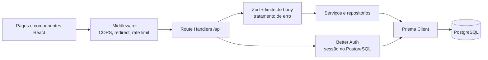

Responsabilidades:

- `src/app`: páginas, layouts e Route Handlers;
- `src/components`: interfaces dos módulos e formulários;
- `src/lib/auth.ts`: Better Auth, origem confiável, sessão e bloqueio de API;
- `src/middleware.ts`: redirecionamento antecipado, CORS, request ID e limite
  básico de escrita;
- `src/lib/api-response.ts`: leitura limitada de JSON, Zod e erros seguros;
- `src/lib/repository.ts`: empresas, sócios e lançamentos;
- `src/lib/fiscal-leve.ts`: regras e persistência do módulo fiscal;
- `src/lib/secret-box.ts`: AES-256-GCM para credenciais fiscais;
- `prisma/schema.prisma`: modelos, relações e índices;
- `prisma/migrations`: evolução versionada do banco.

### 5.2 Fluxo de autenticação

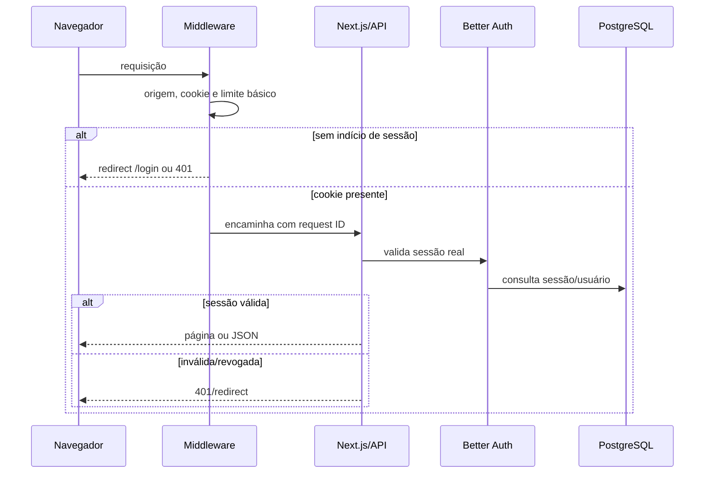

O middleware não é a única barreira: páginas e APIs confirmam a sessão no
servidor. O cadastro público permanece desativado, a senha aceita entre 12 e
128 caracteres e a sessão expira em oito horas.

### 5.3 Modelo de dados

O schema possui quatro grupos principais:

1. **Cadastro:** `Empresa`, `Socio`, `EmpresaSocio`,
   `ReferenciaComercial` e `AlteracaoContratual`.
2. **Financeiro:** `Lancamento`.
3. **Fiscal Leve:** `FiscalEmpresa`, `FiscalTarefa`, `FiscalMei`,
   `FiscalMeiAtividade`, `FiscalMeiFaturamento` e `FiscalConfiguracao`.
4. **Autenticação:** `User`, `Session`, `Account`, `Verification` e
   `RateLimit`.

Quando o banco não está configurado, algumas telas podem abrir dados de
demonstração em modo somente leitura. Escritas são recusadas para evitar uma
falsa impressão de persistência.

## 6. Arquitetura de produção na AWS

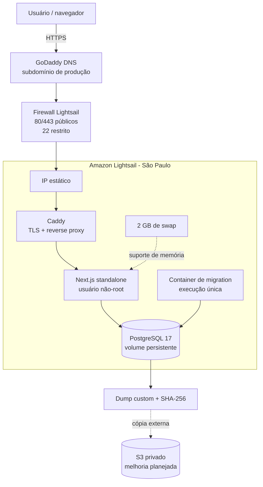

Os containers usam duas redes:

- `frontend`: Caddy e aplicação;
- `backend` interna: aplicação, migration e PostgreSQL.

O PostgreSQL não publica porta no host. O Next.js usa `expose: 3000`, acessível
somente pelo Caddy. Apenas Caddy publica 80/443.

## 7. Por que esta estratégia foi escolhida

O requisito principal era publicar com o menor custo previsível, sem abrir mão
do mínimo de segurança necessário para dados contábeis.

### Opção adotada

- uma instância Lightsail Linux de 1 GB;
- custo-base selecionado no deploy: US$ 7/mês, cobrado por hora até o teto do
  plano, conforme a tabela vigente na data da contratação;
- 2 GB de swap para suportar build e picos de memória;
- PostgreSQL, aplicação e Caddy no mesmo servidor, mas isolados em containers;
- IP estático e DNS no registrador existente;
- orçamento AWS de US$ 10 como alerta inicial.

### Serviços deliberadamente evitados

- RDS;
- ECS/Fargate;
- Application Load Balancer;
- NAT Gateway;
- CloudFront;
- Cognito.

Esses serviços melhoram disponibilidade ou operação em escala, mas aumentariam
o custo e a complexidade antes de existir demanda comprovada.

### Compromissos do plano de 1 GB

- pouca margem de memória;
- build mais lento e dependente de swap;
- aplicação e banco compartilham a mesma falha física;
- manutenção exige disciplina de backup;
- não é a arquitetura indicada para muitos usuários simultâneos.

O próximo degrau recomendado é Lightsail de 2 GB. Depois, se disponibilidade e
volume justificarem, banco gerenciado e múltiplas instâncias.

## 8. Etapas executadas no deploy

### 8.1 Conta e controle de custo

Foi criado um orçamento mensal antes da instância. O budget envia alertas, mas
não funciona como bloqueio de cobrança.

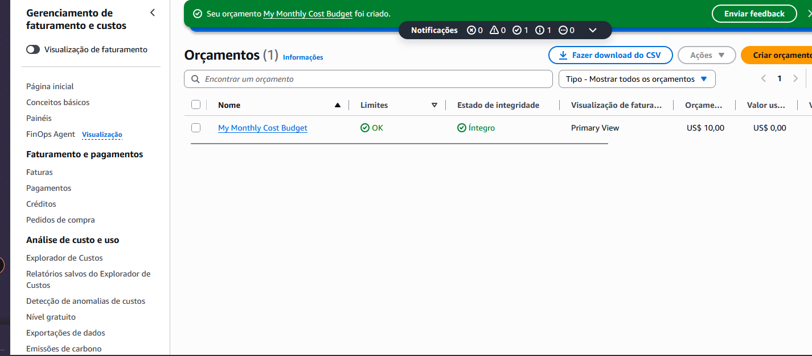

### 8.2 Instância e sistema operacional

Configuração implantada:

- Ubuntu 24.04 LTS;
- região de São Paulo;
- 1 GB de RAM, 2 vCPUs e 40 GB SSD;
- 2 GB de swap persistente;
- atualizações de segurança aplicadas;
- Docker Engine, Compose e Git instalados pelo repositório oficial.

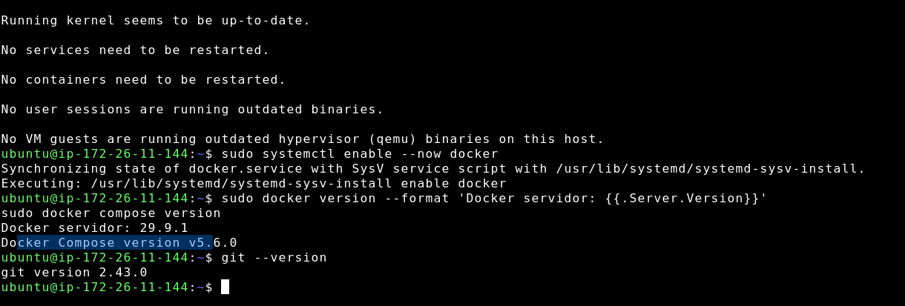

### 8.3 IP, DNS e firewall

Um IP estático foi anexado à instância. O DNS do GoDaddy recebeu um registro
`A` para o subdomínio de produção. O domínio, os endereços IP e os
identificadores dos recursos foram omitidos ou borrados porque este documento é
público.

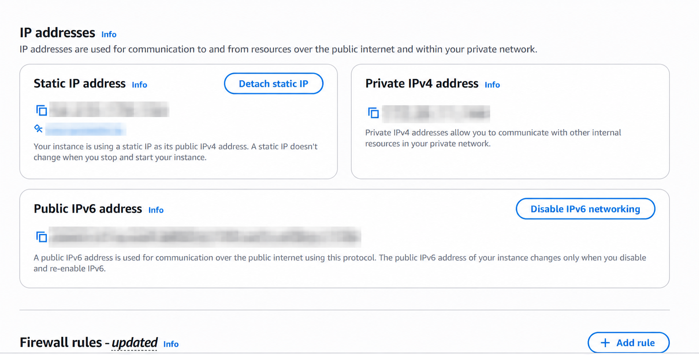

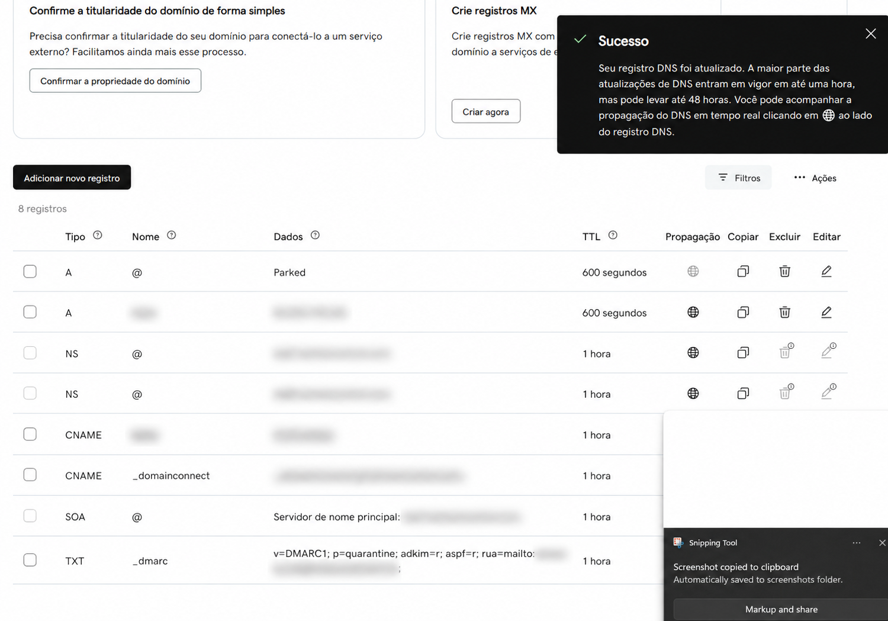

Regras finais esperadas:

- TCP 80 público;
- TCP 443 público;
- UDP 443 público quando HTTP/3 estiver habilitado;
- TCP 22 somente pelo cliente SSH do Lightsail ou por IP administrativo `/32`
  temporário;
- IPv6 desativado na implantação inicial;
- nenhuma regra para 5432.

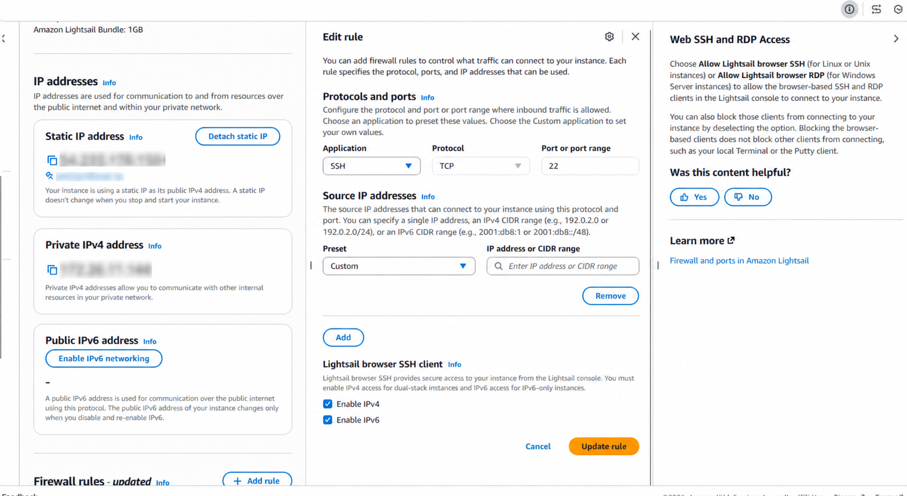

### 8.4 Código e segredos

O repositório foi clonado em `/opt/nexo/app`. O deploy original foi construído
a partir de `cda99c2` (`Envio a producao`). O commit `3ded475` corrigiu o
workflow de verificação posteriormente; CI aprovada não implica que esse commit
já esteja em execução no servidor.

O arquivo `.env.production` recebeu permissão `600` e contém, entre outras:

- credenciais do PostgreSQL;
- `FISCAL_CREDENTIALS_KEY`;
- `BETTER_AUTH_SECRET`;
- domínio e origem oficiais;
- limites de body e escrita.

Os valores não são versionados nem devem aparecer em documentação, log ou
captura de tela.

### 8.5 Backup e restauração

O banco local foi exportado em formato custom do PostgreSQL. O dump e o arquivo
de checksum foram enviados por SCP usando uma regra SSH temporária limitada ao
IP administrativo.

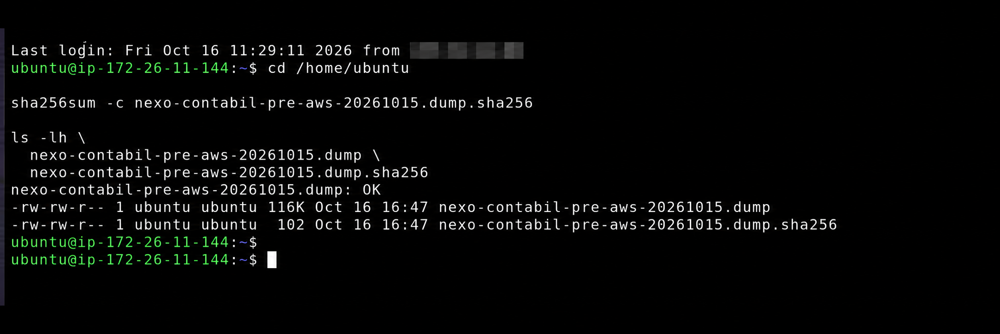

Depois da validação:

1. somente o PostgreSQL foi iniciado;
2. o dump foi copiado para o container;
3. `pg_restore` executou com `--no-owner`, `--no-acl` e
   `--exit-on-error`;
4. o arquivo temporário foi removido do container;
5. migrations e contagens foram conferidas.

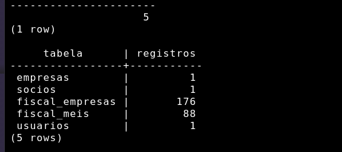

### 8.6 Build e inicialização

O Dockerfile possui múltiplos estágios:

- `dependencies`: instalação imutável por lockfile;
- `builder`: Prisma Client e build Next.js standalone;
- `migrator`: migrations e seed administrativo;
- `runner`: runtime reduzido e usuário `nextjs` sem root.

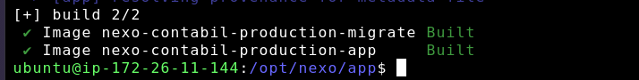

O Compose respeita a ordem:

1. PostgreSQL saudável;
2. migrations concluídas;
3. aplicação saudável;
4. Caddy iniciado.

O Caddy obteve o certificado e passou a responder em HTTPS.

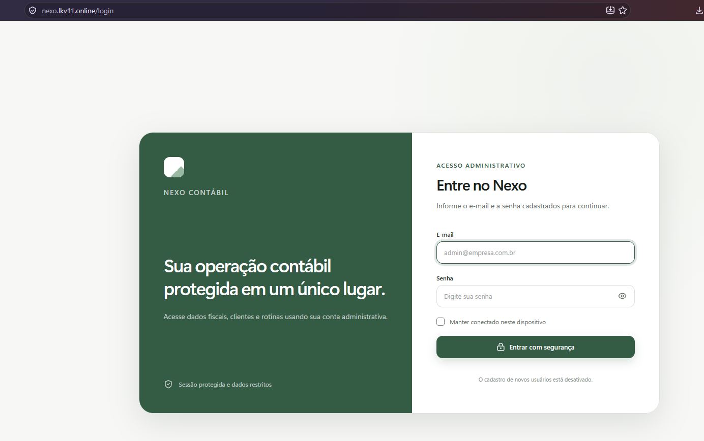

## 9. Validações e evidências

### 9.1 Antes do deploy

Foram executados com sucesso:

```bash
pnpm exec tsc --noEmit --incremental false
pnpm lint
pnpm exec prisma validate
pnpm build
```

Também foram validados:

- migrations locais;
- rotas de API protegidas;
- cadastro público desativado;
- login sintético;
- logout e rejeição do cookie antigo;
- imagem pública executando sem root;
- configuração do Compose;
- build do target `runner` e do target `migrator`.

### 9.2 Depois do deploy

Verificações públicas:

```text
GET /login             -> 200
GET /api/health        -> connected=true, mode=postgresql
GET /api/fiscal-leve   -> 401 sem sessão
```

Proteções observadas:

- HTTPS;
- HSTS;
- CSP;
- `X-Frame-Options: DENY`;
- `X-Content-Type-Options: nosniff`;
- APIs com `Cache-Control: no-store`;
- cookies seguros em produção.

## 10. Problemas encontrados e soluções

| Problema | Causa/risco | Solução aplicada ou recomendada |
| --- | --- | --- |
| Conta sem Free Tier aplicável | custo desde a criação | plano de US$ 7 e AWS Budget de US$ 10 |
| Apenas 1 GB de RAM | build e runtime próximos do limite | 2 GB de swap e logs rotativos |
| AWS CLI ausente no computador local | automação via CLI indisponível | implantação guiada pelo console e SSH |
| `EPERM` no `.next` no Windows | cache/arquivo travado | remover somente `.next` e reconstruir |
| `prisma generate` com `EPERM` no Windows | query engine bloqueado | confirmar geração no build Linux/Docker |
| Opção “My IP” ausente no firewall | mudança da interface Lightsail | regra `Custom` com IP `/32` |
| SSH temporariamente necessário para SCP | browser SSH não transfere o dump | abrir `/32`, enviar, validar e remover a regra |
| Erro ao consultar `.env.production~` | `~` digitado no fim do nome | usar o caminho exato sem sufixo |
| Segredo exibido com `cat .env.production` | credencial capturada na tela | rotacionar PostgreSQL, chave fiscal e segredo Auth antes de iniciar serviços |
| Ferramenta de navegador não alcançou o domínio | isolamento da ferramenta | validar externamente por PowerShell |
| CI aprovada, mas versão antiga no servidor | CI não faz deploy | conferir commit do runtime, rebuild e restart explícitos |
| Sessão poderia sobreviver brevemente ao logout | cache de sessão no cookie | cache removido e cookie antigo testado com retorno 401 |

## 11. Operação e manutenção

### 11.1 Consultar o estado

```bash
cd /opt/nexo/app

sudo docker compose \
  --env-file .env.production \
  -f compose.production.yaml \
  ps
```

### 11.2 Consultar logs

```bash
sudo docker compose \
  --env-file .env.production \
  -f compose.production.yaml \
  logs --tail=100 app postgres caddy migrate
```

### 11.3 Publicar uma nova versão

Antes de atualizar, crie e valide um backup.

```bash
cd /opt/nexo/app
git fetch origin
git pull --ff-only origin main

sudo docker compose \
  --env-file .env.production \
  -f compose.production.yaml \
  build app migrate

sudo docker compose \
  --env-file .env.production \
  -f compose.production.yaml \
  up -d --wait --wait-timeout 300
```

Depois, confira commit, health, logs e autenticação.

### 11.4 Backup de produção

O script `scripts/backup-production.sh`:

- executa `pg_dump` em formato custom;
- gera SHA-256;
- valida com `pg_restore --list`;
- pode enviar dump e checksum para S3 com SSE-S3.

No servidor, instale `postgresql-client` antes de usá-lo. Como o usuário
`ubuntu` não recebeu acesso direto ao socket Docker durante a implantação, o
script deve ser executado com privilégio apropriado ou ajustado para o modelo
operacional escolhido.

Backup não está concluído até existir uma restauração de teste registrada.

### 11.5 Comandos que exigem cuidado

Nunca execute sem backup confirmado:

```bash
docker compose down -v
docker volume rm nexo-contabil-production_postgres_data
```

O `-v` remove o volume persistente do PostgreSQL.

## 12. Privacidade e tratamento dos prints

Este repositório não deve conter prints com dados pessoais completos.

Política usada neste documento:

- capturas que mostravam `.env`, senhas ou segredos foram excluídas;
- captura com ID da conta AWS foi excluída;
- IP residencial/administrativo foi borrado;
- nenhum nome ou CNPJ de cliente foi publicado;
- o dump do PostgreSQL permanece ignorado pelo Git.

Se uma captura funcional com clientes for adicionada futuramente:

- ocultar pelo menos metade de cada nome;
- ocultar pelo menos metade dos dígitos do CNPJ;
- ocultar CPF, e-mail, telefone, endereço e credenciais;
- verificar visualmente a imagem final antes do commit;
- preferir dados sintéticos quando a finalidade for apenas demonstrativa.

Exemplos fictícios de mascaramento:

```text
Empresa Demonstração Ltda. -> Empresa Demo****** Ltda.
12.345.678/0001-90         -> 12.345.***/****-90
```

## 13. Melhorias futuras

### Alta prioridade

1. Concluir e registrar login, Fiscal Leve, logout e bloqueio pós-logout.
2. Criar backup diário automático e cópia externa criptografada.
3. Executar restauração de teste periodicamente.
4. Ativar snapshot automático e controlar sua retenção/custo.
5. Criar usuário administrativo separado na AWS com MFA e reservar root para
   tarefas excepcionais.
6. Trocar e guardar a senha administrativa definitiva em gerenciador de
   senhas.

### Evolução técnica

- automatizar deploy depois do CI, com ambiente protegido e aprovação;
- publicar imagens em registry para não compilar no servidor de 1 GB;
- adicionar monitoramento de memória, disco, health e certificado;
- alertar quando backup ou health falhar;
- formalizar política de retenção e descarte conforme LGPD;
- introduzir auditoria para ações sensíveis;
- adicionar testes automatizados de autenticação e rotas críticas;
- distribuir rate limiting quando houver múltiplas instâncias;
- criar papéis e escopo por organização antes de permitir novos usuários;
- remover a competência fiscal fixa do código e torná-la configurável;
- subir para 2 GB de RAM quando swap, latência ou concorrência indicarem;
- separar PostgreSQL quando disponibilidade e recuperação justificarem RDS.

## 14. Checklist de encerramento

### Infraestrutura

- [x] Lightsail criado na região de São Paulo.
- [x] IP estático anexado.
- [x] DNS apontado.
- [x] HTTP/HTTPS públicos.
- [x] PostgreSQL sem porta pública.
- [x] Docker com logs rotativos.
- [x] Swap configurado.

### Aplicação e dados

- [x] Imagens `app` e `migrate` construídas.
- [x] Dump validado por SHA-256.
- [x] Banco restaurado.
- [x] Migrations conferidas.
- [x] Contagens conferidas.
- [x] Health público conectado ao PostgreSQL.
- [x] API fiscal anônima bloqueada.
- [ ] Login manual definitivo registrado.
- [ ] Fiscal Leve autenticado conferido no navegador.
- [ ] Logout e bloqueio posterior registrados.

### Operação

- [x] AWS Budget criado.
- [ ] Snapshot automático confirmado.
- [ ] Backup externo diário confirmado.
- [ ] Restauração periódica agendada e testada.
- [ ] Monitoramento e alertas configurados.
- [ ] Usuário AWS administrativo separado do root.

## Referências internas

- [Guia do AWS Lightsail](AWS-LIGHTSAIL-PRODUCAO.md)
- [Checklist do Fiscal Leve](FISCAL-LEVE-PRODUCAO.md)
- [Manual do banco de dados](MANUAL-BANCO-DE-DADOS.md)
- [`compose.production.yaml`](../compose.production.yaml)
- [`Dockerfile`](../Dockerfile)
- [`deploy/Caddyfile`](../deploy/Caddyfile)
- [Workflow de verificação](../.github/workflows/verify.yml)

